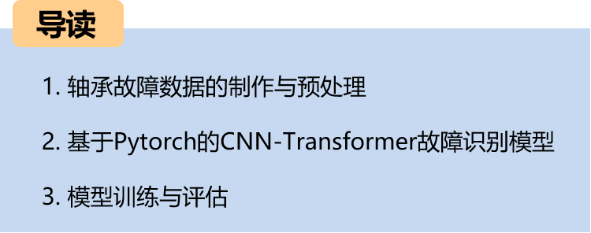
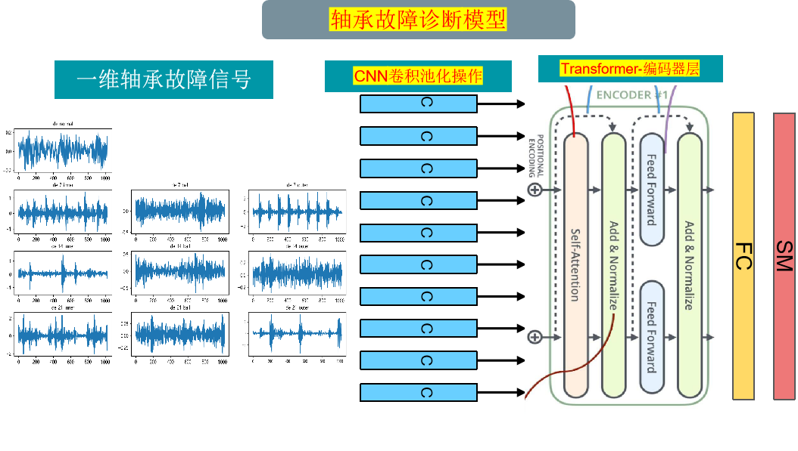
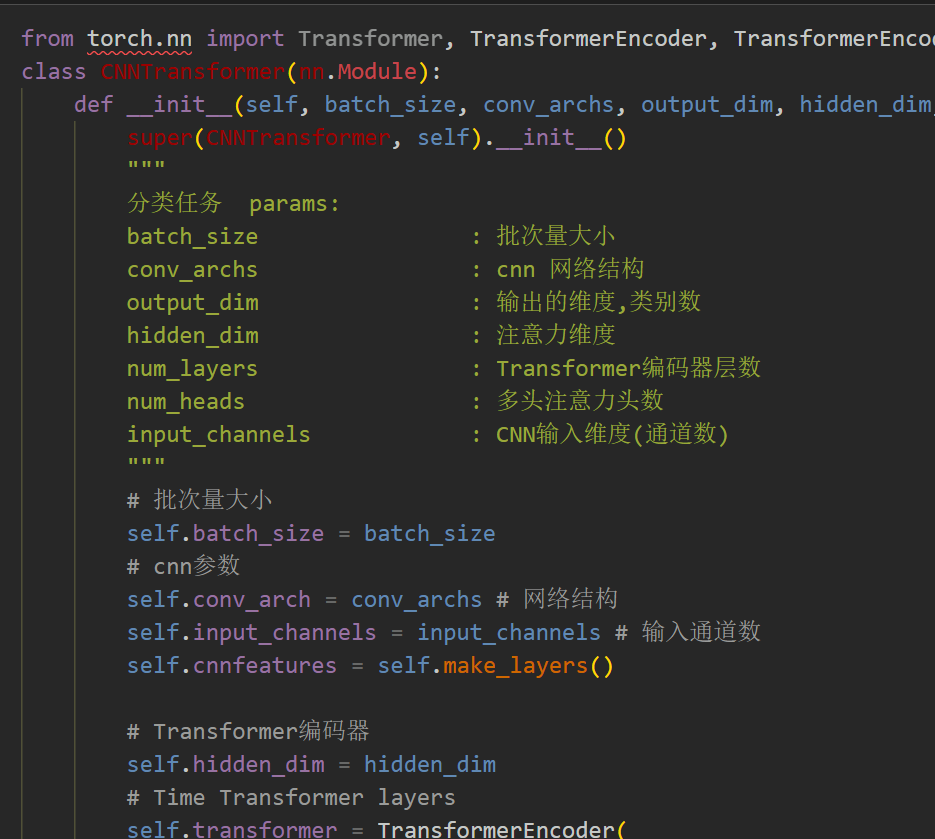
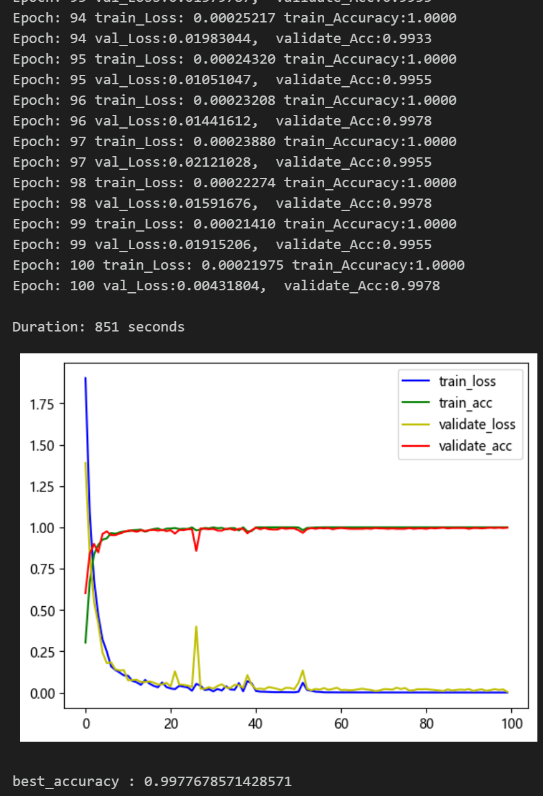
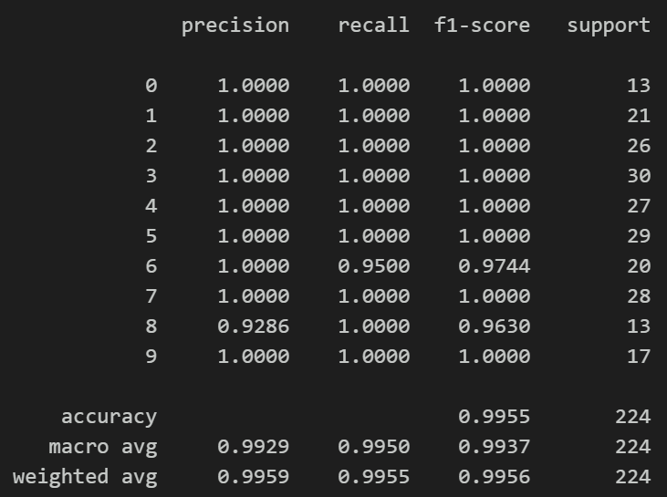
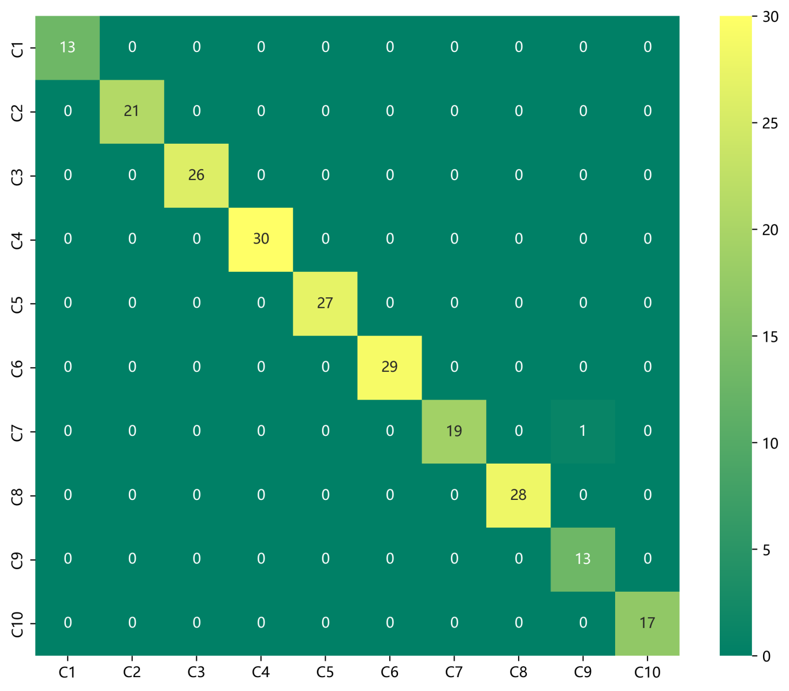
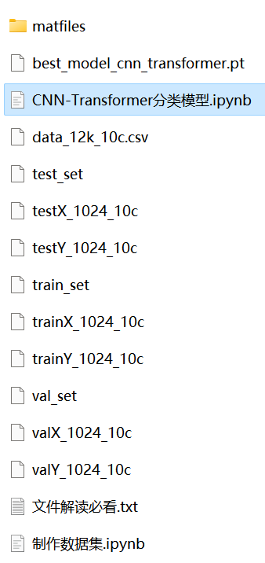

# Bearing Fault Identification: One-Dimensional Fault Signal Diagnosis Model Based on CNN-Transformer

The content includes:
- Complete CWRU bearing fault dataset, as well as the generated fault signal dataset, classification data, and label set. The code for all operations can be run successfully.
- 100 epochs with an accuracy of 100%. The classification effect of the CNN-Transformer network is significant. The model can fully extract spatial, temporal, and frequency domain features of bearing fault signals. The convergence speed is fast, and the performance is excellent with high precision. Innovation is also present!!!
- Includes the code for data preprocessing and the CNN-Transformer classification code.
Environment: Python 3.9
Innovation point: Utilize cross attention mechanism to fuse models!
Preface
This article is based on the bearing data from Case Western Reserve University (CWRU), first through data preprocessing to create and load the dataset, and finally implement the CNN-Transformer model to classify the fault data using Pytorch. For a detailed introduction to the CWRU bearing data, please refer to the following article:
Python-Case Western Reserve University (CWRU) Bearing Data Interpretation and Classification Processing
Overall Model Structure
The overall structure of the model is as follows:
1. Bearing data loading and preprocessing
1.1 Import data
Refer to previous articles for the preprocessing of fault classification in 10 categories, with the CWRU bearing data 10-category dataset:
train_set, val_set, test_set are divided into training set, validation set, and test set at a ratio of 7:2:1, and finally save the data.
The above figure shows the reading form of the data and the preprocessing idea.
1.2 Data preprocessing, creating the dataset
3. Based on Pytorch's CNN-Transfromer bearing fault diagnosis classification
3.1 Define the CNN-Transfromer classification network model
\tNote: The input data dimension is [32, 1, 1024]. First, it enters the CNN network for 1D convolutional pooling, then the spatial features from the convolutional pooling are fed into the Transformer for signal feature enhancement. Finally, it is sent to a fully connected layer and softmax for classification.
\t3.2 Set parameters and train the model
\t100 epochs, with an accuracy nearing 100%. The CNN-Transformer network has significantly improved classification results. The CNN-Transformer model can fully extract global spatial and local features of bearing fault signals, with fast convergence speed and exceptional performance, resulting in noticeable effects.
\tNote on parameter adjustments:
\tAdjust the number of CNN layers and hidden layer dimensions appropriately, adjust learning rate;
\tIncrease the number of Transformer encoder layers and dimensions, increase more epochs (be cautious to prevent overfitting);
\tChange the shape of one-dimensional signal stacking (set appropriate length and dimensions);
\t3.3 Model evaluation
\tAccuracy, Precision, Recall, F1 Score
\tFault classification confusion matrix:

## Images

<!-- PAYMENT_BLOCK -->

## Get this dataset

- Payment link (Stripe): [Buy now](https://buy.stripe.com/3cs8yP7sY87d0vu9AB)
- Payment QR code: 

<!-- /PAYMENT_BLOCK -->
